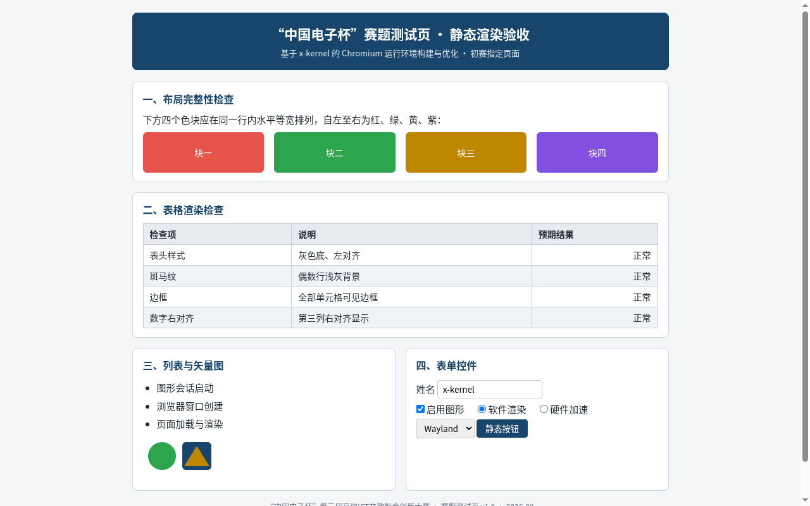

# R66：R64 compatibility 候选 cold-start repeat 02

R66 使用与 R65 同一内核二进制 SHA `a70ecb4a34910f56c31d677f1b27d3a25088b94dc2fc82ba13b33544f34e3c1f`，2 GiB AArch64 pure TCG、Chromium 149.0.7827.53，2400 秒 page deadline、一次真实 Ctrl+R 和 420 秒诊断保持。QEMU `-kernel` 路径和运行配置中的预期哈希均匹配。

guest 240 秒周期截图是暖机白帧（严格 1/7）；stable driver 捕获的 initial page 和真实 Ctrl+R 后的 reload page 均通过官方 index 严格判据 7/7，guest 540 秒周期截图也通过。driver `pass=1 duration=420.0 reloads=1/1`，事件归一化 306/306 PASS、0 修复，driver/round 返回 0。正式 gate 因 diagnostic-only 跳过（rc=78）。没有 Wayland reset。

R66 与 R65 构成相同 `a70ecb4a…` binary hash 的两次独立 cold-start page/reload 短稳定诊断通过。两轮仍不是正式 30 分钟稳定性样本，未启用内存/生命周期采样，没有性能指标。540 秒只是周期截图上界，不是首帧 latency。

原始 PPM 保留在 T490 `/home/mo/xk6/evidence/2026-11-22_t490-r66-r64-compat-cold03`；哈希见 [R66 PPM 清单](../_ppm-sha256-r66-r64-compat-cold03.txt)。PNG 预览：

干跑和实际命令、环境、QEMU transcript、事件、构建指纹和运行汇总都在本目录。详细分析见 [R66 报告](../../report/439-T490-R66-a70e候选第二次页面冷启动通过-20261122.md)。
