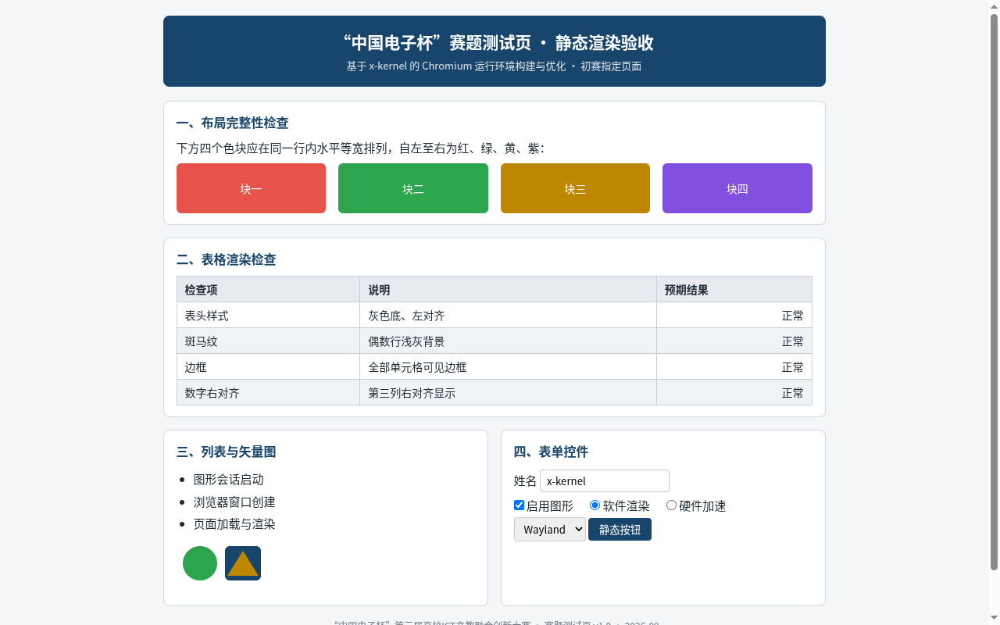
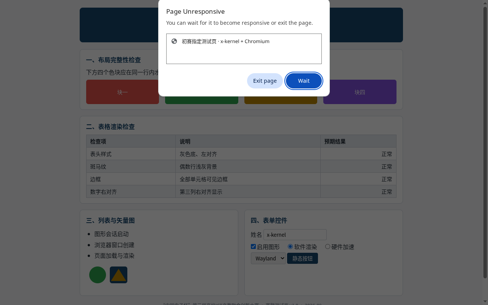

# T490 最终候选内核稳定性复测：第八次重载出现页面无响应（2026-11-19）

## 结论

最终 Browser-run 内核 `ac1032fe98c382cc37646a12453b7141b789c9abfe1651ff5f8f1e0263767fa2` 在 2 GiB、AArch64 纯 TCG 条件下完成了 1,805.001 秒保持，但完整稳定性 gate **失败**：初始首页 strict 通过；前 7 次真实 QMP `Ctrl+R` 重载 strict 通过；第 8 次在 90 秒重载窗口内未通过，并出现 Chromium “Page Unresponsive” 对话框。driver 因此没有发起第 9、10 次重载。

本轮结果不能作为 10/10 稳定性通过证据。Weston/Browser watchdog 在 60 个 host liveness 样本中始终报告存活；未观察到 QEMU/Weston 退出或 OOM。根因尚未确定。

## 固定条件与命令

- T490 `10.249.11.192`，Ubuntu 26.04.1、Linux 7.0.0-43、QEMU 10.2.1；guest AArch64、`-m 2g`、4 vCPU、纯 TCG、1280×800 virtio GPU/keyboard/mouse，Weston/原生 Wayland。
- Chromium 149.0.7827.53；Chromium 可执行文件 SHA-256 `d7d89bcb466c1d9a7ab209220c8ab997f66c02b77c5e80d3ea10ed64c772a641`；基础镜像 SHA-256 `bab5c9f5dbf1e4a910bab569635bb9e44fe38c3b8cea94ae8eae4ce3f7a9fdb1`。
- kernel binary SHA-256 `ac1032fe98c382cc37646a12453b7141b789c9abfe1651ff5f8f1e0263767fa2`。
- 延用 `--js-flags=--jitless`、`--ipc-connection-timeout=600`；QMP 首屏采样间隔 30 秒，重载检查间隔 5 秒，重载窗口 90 秒；family watchdog 14 guest 秒，family 诊断开启。
- 实际命令：`MP_FAMILY_WATCHDOG_INTERVAL=14 MP_FAMILY_DIAGNOSTICS=1 bash scripts/t490/run_stability_round_mp.sh codex-2026-11-19_185145-stability 4200 30`。

## 结果数据

| 项目 | 结果 |
|---|---|
| 首次首页 strict | 496.759 秒；QMP 首屏采样间隔 30 秒，属于采样上界 |
| strict 保持 | 1,805.001 秒，达到 30 分钟口径 |
| 初始页面与重载 | 初始页面通过；7/10 次重载通过；第 8 次第 16 次轮询时仍失败，随后 nav-08 超时；nav-09/nav-10 未发起 |
| host liveness | 60 个样本全部报告 QEMU running；guest watchdog 均报告 Weston 与 Browser 存活 |
| 异常与 OOM | 未观察到 OOM、Weston 退出或 QEMU 提前退出 |
| 子步骤返回码 | Driver 1、round 0、normalizer 0、stability gate 1 |
| 最终 gate | FAIL：`found 8 reload requests, expected 10` |

## 第八次重载现场

nav-08 触发后 90 秒内共进行 16 次 strict 截图检查，均未通过。超时 PPM 的后验 strict 检查为 1/7：标题 banner、四色块布局与表格签名未能识别；可视截图显示 Chromium 的 “Page Unresponsive” 对话框遮挡页面。nav-07 的前一张通过截图严格集为 7/7。

nav-08 附近的 guest family watchdog 记录 5 个进程成员，均为可运行/可睡眠的 S 状态；当时 free memory 约 530,148 KiB。该快照没有证明 renderer 主线程健康，也没有确定无响应的根因。页面无响应是本轮真实失败，需在后续独立最小复现中定位。

本轮 console 中累计约 43.4 MB 日志；计数包含大量 `futex TimedOut`、`fstatat NotFound`、`wait4 ECHILD`、`ioctl NotATty` 以及 IPC/epoll 跟踪记录。它们是后续分类与性能开销分析的线索，本报告不把日志数量直接解释为页面无响应的原因。

## 证据与校验

- [T490 原始证据镜像（保留日志、判据、事件与哈希清单；仓库副本不含 PPM）](../evidence/2026-11-19_t490-stability-ac1032-r1/remote/2026-11-19_t490-codex-2026-11-19_185145-stability/)
- [完整稳定性事件 JSONL](../evidence/2026-11-19_t490-stability-ac1032-r1/remote/2026-11-19_t490-codex-2026-11-19_185145-stability/stability/stability-events.jsonl)、[driver 结果码](../evidence/2026-11-19_t490-stability-ac1032-r1/remote/2026-11-19_t490-codex-2026-11-19_185145-stability/stability-result.env)、[gate 日志](../evidence/2026-11-19_t490-stability-ac1032-r1/remote/2026-11-19_t490-codex-2026-11-19_185145-stability/stability-gate.log)。
- 原始 PPM 共 78 张，继续保存在 T490 的 `/home/mo/xk6/evidence/2026-11-19_t490-codex-2026-11-19_185145-stability/`；[PPM SHA-256 清单](../evidence/2026-11-19_t490-stability-ac1032-r1/remote/2026-11-19_t490-codex-2026-11-19_185145-stability/stability-ppm-sha256.txt)已归档。仓库只保留三张可查看 PNG 和 PPM 哈希，不提交原始 PPM。
- 远端 `stability-bundle-sha256.txt` 所有仓库内文件哈希均已逐项复核；78 个本地省略 PPM 与 T490 上的原始 PPM 清单对应。
- `final-acceptance.sh stability` 的本地 SSH 包装连接在远端证据打包后未返回，外层 rc=255；远端 `stability-result.env` 与 `stability-gate.log` 完整记录实际子步骤结果。外层连接异常未覆盖远端的 gate FAIL。
