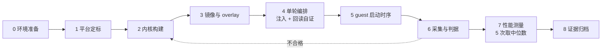
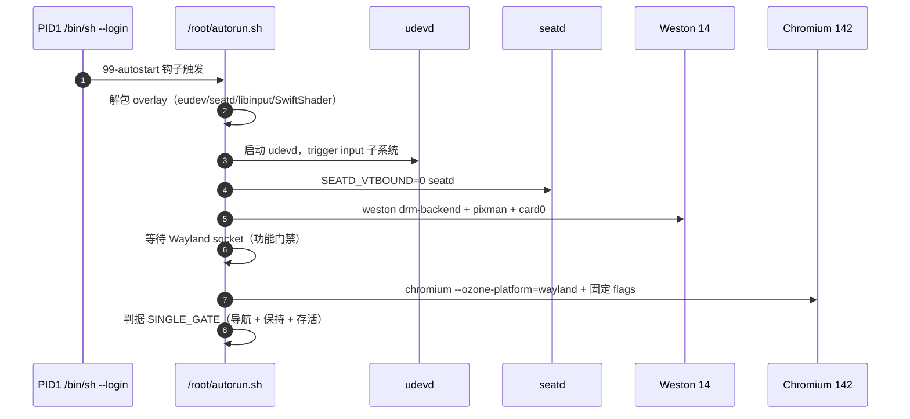

# 60 · 项目全景梳理与零基础系统学习路径

> **本文两部分，面向两类读者：**
> - **Part A · 项目全景**：给需要快速掌握"项目做到哪了、系统长什么样、每个模块在哪"的队员与协作者。所有事实均可回溯到 `report/` 编号报告与 evidence 目录。
> - **Part B · 零基础系统学习路径**：给第一次接触本项目、需要从零上手的人。以"资深技术专家带教"的视角设计，按步骤拆解，每步说明**为什么这样设计、解决什么问题、有哪些注意事项**。
>
> 写作口径：只写已归档可复核的事实；未闭环项显式标注"未闭环"，不写成"已通过"。本文是**索引与导读**，不替代原始报告与证据。

---

## Part A · 项目全景

### A.1 项目是什么（一句话 + 三层结构）

> 在**赛题指定的 AArch64 QEMU 纯 TCG 虚拟平台**上，让 Rust 内核 **x-kernel** 驱动 **Weston 图形会话**与 **Chromium 浏览器**跑起来，正确渲染指定 HTML 页面并稳定不少于 10 分钟；同时提交**内核兼容性缺口、修复补丁、可复现的测量方法与原始数据**。

这不是"写业务代码"题，而是一道**移植 + 兼容性**题：内核已能启动、能跑 shell，但跑不动大型用户态图形程序——全部工作围绕"找出并补齐它缺的能力"。

```
┌────────────────────────────────────────────────────────────┐
│ 用户态（40 分）  udevd + seatd + Weston 14 + Chromium 142   │
├────────────────────────────────────────────────────────────┤
│ 内核态（25 分）  x-kernel：ksyscall / DRM / VFS / mm / net  │
├────────────────────────────────────────────────────────────┤
│ 平台层（红线）    AArch64 + QEMU 纯 TCG + 四类 virtio 设备   │
└────────────────────────────────────────────────────────────┘
```

**三条不容违反的红线**（违反则该部分数据作废）：

1. 评分数据必须纯 TCG（命令行无 `-accel`，CPU 为 `cortex-a76`，禁用 `-cpu host`）；
2. 功能证据只认 **QEMU monitor `screendump`** 原始 PPM（主机录屏仅作演示辅助）；
3. 平台参数只认**单一真源** `scripts/t490/platform.env`，改参数不得散落在脚本里。

### A.2 进度快照（截至 2026-10-14 晚）

| 板块 | 状态 | 关键事实 |
|---|---|---|
| 初赛提交包 | ✅ 已冻结 | 242 文件 / 33.9 MB / SHA-256 `c118afa4…`；材料 rev `330c5edf`、内核 rev `2a1b101` |
| 功能主流程 | ✅ 通过 | 干净目录 900 秒轮：`SINGLE_GATE=1`、保持 615 秒、13 张 official-index 严格判据全过 |
| JS 交互 | ✅ 页面级 | CDP 驱动 T1–T6/F1 全绿、文本回显；**硬件 virtio-input 链未闭环**（缺口 G8） |
| CSS 布局 | ✅ 两组证据 | 滚动结论条 6/6（新轮）+ 首屏几何 5/5（历史轮原件补齐） |
| 性能观测 | ✅ 5 轮 | 导航首采样 75 s、首张通过截图 180.2 s、宿主 RSS 中位 1,695,736 kB、CPU 中位 176.8%；改善对照未形成，不申请改善档位 |
| 演示视频 | ✅ 实拍 | 2026-10-14 OBS 实录 945 秒 / 1280×800 / 30 fps（`4ae0bd76…`） |
| 上游贡献 | 🟡 进行中 | 文档 MR `!831` 已合并；行为修复 PR `!1003`（MSG_CMSG_CLOEXEC）open，CI 2086 SUCCESS、审阅 recommend merge、CLA 待上游刷新 |
| 材料发布 | ✅ 已推 | GitHub 分支 `codex/initial-submission-complete`@`330c5edf`；镜像走 Release（344 MB xz）；内核 fork 在 Gitee |
| 线下事项 | ⏳ 剩余 | 报名表/汇总表填写、盖章提交（不属技术材料） |

**一句话概括**：初赛六件套（技术方案 / 代码仓库 / 构建配置 / 测试脚本 / 运行日志 / 演示视频）全部就位并冻结；唯一技术上仍在动的线是上游 PR `!1003` 的评审与 CLA 流程。

### A.3 系统架构

#### A.3.1 端到端启动链

```mermaid
flowchart TB
    subgraph HOST["宿主 · T490 裸金属 Ubuntu 26.04 x86_64"]
        H1["platform.env<br/>平台参数单一真源"]
        H2["t490_platform_check.sh<br/>合规断言 15 项"]
        H3["t490_round.sh<br/>单轮编排"]
        H4["QEMU 10.2.1 纯 TCG<br/>2g / 4 vCPU / cortex-a76"]
        H5["screendump 取证 + ppm_assert.py 判据"]
    end

    subgraph KERN["guest 内核 · AArch64 x-kernel"]
        K1["core/ksyscall<br/>syscall 分派约 250 项"]
        K2["io/drmdevice<br/>DRM/KMS ioctl"]
        K3["drivers/devices/virtio<br/>gpu / input / blk / net"]
        K4["fs + mm + net/knet<br/>文件系统 / 内存 / IPC"]
    end

    subgraph USER["guest 用户态 · agentos-weston.img"]
        U1["udevd + seatd"]
        U2["Weston 14<br/>DRM backend + pixman"]
        U3["Chromium 142<br/>ozone wayland + SwiftShader"]
        U4["官方三页 HTML<br/>index / interaction / layout"]
    end

    H1 --> H2 --> H3 --> H4
    H4 --> KERN
    KERN --> USER
    USER --> H5
    H5 --> H3
```



#### A.3.2 证据生产流程（单轮八阶段）



心法：**每一阶段都有产出物，下一阶段只消费上一阶段的产出**。任何一环断了，都会在后面以"现象"形式暴露——定位时回到产出物那一环去查，而不是在现象处硬猜。

#### A.3.3 guest 内启动时序



### A.4 核心模块实现情况

#### A.4.1 宿主侧工具链（评分支撑 + 可复现性）

| 模块 | 关键文件 | 实现情况 |
|---|---|---|
| 平台真源 | `scripts/t490/platform.env` | ✅ `GRAPHIC=y ACCEL=n MEM=2g SMP=4 VSOCK=n`；比赛参数唯一出处 |
| 合规预检 | `scripts/t490/t490_platform_check.sh` | ✅ 完整预检 35 项断言（归档输出 `PASS=35 FAIL=0 WARN=1`）；每轮证据里的 `platform-compliance.txt` 是实跑命令行断言 15 项（`PASS=15 FAIL=0`，每轮硬门槛） |
| 单轮编排 | `scripts/t490/t490_round.sh` | ✅ 换镜像→编译探针→debugfs 注入→回读校验→起会话→回收日志 |
| 会话引擎 | `scripts/run-session.py`、`scripts/qemu_window.py` | ✅ 起 QEMU、定时 screendump、对实跑命令行再次断言；GTK 窗口固定 1280×800 |
| 像素判据 | `scripts/t490/ppm_assert.py` + `ppm_assert_selftest.py` | ✅ 三套 profile（index/interaction/layout）；四类对照自检 28/28 |
| 性能测量 | `scripts/t490/measure-single-initial.sh`、`collect_single_metrics.py`、`observe_qemu.py` | ✅ 5 轮编排 + raw.csv/summary.json + 宿主 `/proc` fallback |
| 一键复现 | `scripts/t490/reproduce_submission.sh` | ✅ `--prepare / --check / --dry-run / --run` 四档 |

#### A.4.2 内核侧（25 分核心，x-kernel @ `2a1b101`）

| 子系统 | 代码落点 | 项目中的角色 |
|---|---|---|
| syscall 分派 | `core/ksyscall/src/dispatch.rs`（约 250 个分支） | **内核能力清单第一真源**；缺口排查从这里读起 |
| DRM/KMS | `io/drmdevice/src/card0.rs`（约 1486 行）、`consts.rs` | 图形链路核心；ioctl 编号+结构体大小双维度必须对齐 Linux uapi |
| 虚拟设备驱动 | `drivers/devices/virtio/`（gpu/input/blk/net/pci/rng） | 对接 QEMU 的 virtio 设备 |
| 设备契约 | `drivers/contracts/display` 等 | 定义 `ScanoutFormat` 等抽象边界 |
| 文件系统 | `fs/kvfs` + `fs/filesystems`（devfs/procfs/sysfs/memfs/pipefs） | `/dev/dri/card0`、`/proc/*`、`/sys/class/drm/*` 等设备的"存在性" |
| 内存管理 | `mm/memspace`、`anon/pagecache/kalloc` | mmap/madvise/写时复制/页缓存 |
| 网络与 IPC | `net/knet`（unix/netlink/tcp） | Wayland socket、Mojo fd 传递、udev netlink |
| 执行体 | `task/`、`process/`、`posix/` | 进程/线程/调度/futex/signal/语义层 |

#### A.4.3 用户态（镜像与运行时）

| 模块 | 内容 | 为什么必须 |
|---|---|---|
| 基础镜像 `agentos-weston.img` | Alpine 3.22 + Weston 全家桶 + Chromium 142 | 上游测试镜像没有 Weston/seatd，而官方意图路线是 Weston + Wayland |
| 运行时 overlay p31 | eudev / seatd / libinput / SwiftShader | 没有它：udev 组订阅、input uevent、CPU 光栅全不成立 |
| autostart 钩子 | `/etc/profile.d/99-autostart.sh` | 镜像**没有**这个文件，不注入则 `/root/autorun.sh` 永不执行（整轮静默空跑） |
| 官方三页 | `scripts/testpage/{index,interaction,layout}.html` | 判据载体；三页互链，必须整目录注入并 debugfs 回读 |
| Chromium flags | `--single-process --no-zygote --in-process-gpu` + Ozone/Wayland + SwiftShader | 初赛稳定候选；多进程 renderer 未打通，明确不宣称 |

#### A.4.4 证据与判据体系

- **唯一提交证据集** `evidence/t490-final/`：7 个子目录（main / display-check / interaction / layout / compatibility / performance / video-context），每份原件逐字节保留并有 `manifest.csv` 记录来源、大小、SHA-256。
- **判据链**：monitor screendump → PPM → `ppm_assert.py` → JSON/`ppm-summary.txt`。判据常量来自参考图实测值，不靠 CSS 反推。
- **三条页面事实**（实测，别记错）：index 是无脚本静态页（不能做双帧差分）；interaction 自检必须有真实点击（未点击结论条是灰的）；layout 的 6/6 结论条在整页 y≈1450，1280×800 首屏看不到。

### A.5 兼容性缺口与补丁现状

**8 条缺口（G1–G8）**，每条按"现象 → 最小复现 → Linux 对照 → 影响 → 补丁/限制"组织：

| 缺口 | 内容 | 当前状态 |
|---|---|---|
| G1 | fd 表下界与 zygote fd 继承语义 | 探针 PASS；完整 zygote 协议未证 |
| G2 | Unix ancillary（SCM_RIGHTS/CREDENTIALS/CLOEXEC）+ DGRAM/SEQPACKET 半关闭 | 专项探针 PASS；完整 renderer 生命周期未证 |
| G3 | `ppoll_time64` 分派 | libc 原生路径 PASS；全 ABI 未证 |
| G4 | procfs 线程/状态/内存/uptime 字段 | uptime 动态化已验证；完整记账未证 |
| G5 | `PR_SET_PDEATHSIG` 最小语义 | set 返回 0 但 get 读回 0，**FAIL（如实归档）** |
| G6 | TCP keepalive 选项 | set/get PASS；实际探测行为未证 |
| G7 | PI futex 返回 `EOPNOTSUPP` + NOFILE 边界 | 按设计返回；65536 fd 容量未支持 |
| G8 | **virtio-input 事件消费链未打通** | QMP 注入成功、内核无消费；evprobe 仅枚举节点 |

**补丁集** `report/patches/`：17 个文件（`0001`–`0018`，缺 `0008`）。注意 `0011`/`0013` 是历史导出、已分别被 `0018`/`0017` 覆盖，**不得重复应用**。

**上游协作**：

- `!831`（README/defconfig 路径文档修复）：**已合并**（上游落点 `0a04f7dc…`）；
- `!1003`（honor MSG_CMSG_CLOEXEC for received fds）：**open**——CI 构建 2086 SUCCESS、review "recommend merge"、CLA `openkylin-cla/no` 待上游刷新；配套 Starry harness 测试 PR `193` open；
- 审计结论（report/58）：本地旧补丁中 `0003`/`0005`/`0001` 等已被上游后来修复，**不重复提交**；`0002` 与上游开放 PR 竞争，优先提供可复现测试。

### A.6 关键数值快照（口径必读）

| 项 | 值 | 口径说明 |
|---|---|---|
| 材料 rev / 内核 rev | `330c5edf` / `2a1b101` | 材料=GitHub 仓库分支；内核=Gitee fork 分支 |
| 基础镜像 | `bb25e0b2…` | 冻结镜像；Release 分发的 xz 为 `6ed1bff7…` |
| overlay p31 | `56dba17c…` | 运行时补包 |
| 主功能保持 | 615 秒 | `SINGLE_HOLD_REACHED`；录制轮浏览器保持 795 秒 |
| 导航首次采样 | 75 s（中位） | **15 秒采样粒度下的首次发现**，不是精确加载耗时 |
| 首张通过截图 | 180.2 s | `FIRST_SHOT=180` 定时截图，不是"页面 180 秒才加载完" |
| 宿主 RSS 中位 | 1,695,736 kB | 宿主 QEMU 进程边界，**不能写成 guest Chromium 指标** |
| 宿主 CPU 中位 | 176.8%（单核尺度） | 同上边界 |
| 视频 | 945 秒 / 1280×800 / 30 fps | 10-14 实拍；裁 guest 区域、去尾部 2 秒 |

### A.7 遗留事项与决赛方向

**初赛线剩余（非技术）**：报名表/汇总表填写、盖章提交。

**技术线（决赛方向，初赛一律不宣称）**：

1. virtio-input 事件消费链（`devfs/src/nodes/event.rs`：鼠标暴露成 `mice`、minor 未用 `64+N`；另需 input sysfs 的 `ID_INPUT*` 投射）；
2. 多进程 renderer/zygote 稳定；
3. 30 分钟稳定、双窗口/多标签页、1.5 GiB 内存线；
4. 上游 `!1003` 走完评审与 CLA 流程；按 report/58 优先级继续整理后续 PR。

**纪律**：用户态 flags/shim/测试页只作诊断、过渡、测量手段，**不得写入优化收益表**；判定只认归档文件，不凭报告转述。

---

## Part B · 零基础系统学习路径

### B.0 先立三条设计原则（专家的入场逻辑）

**原则一：先闭环，后深入。** 第一步不是学知识，而是在现成的轮子上**跑通一轮、看到"正确的样子"**。没见过正确运行，就没有资格判断故障——这是所有调试能力的参照系。

**原则二：从现象倒推能力，不从代码正推结构。** 内核侧学习入口是"能力表 + 日志现象"，不是从第一行内核代码读起。项目纪律原话："遇'图形起不来'先读内核能力表，再定用户态怎么用。"反过来做（在用户态堆启动脚本、用排除法倒推内核）已经真实浪费过整轮整轮的时间。

**原则三：证据驱动，结论可复核。** 每个学习成果都要落到"一条可复现命令 + 一份归档输出"。不许"看着像通过"。这是评分方法对能力的要求，也是工程素养本身。

**零基础口径**：会至少一门编程语言、懂基本计算机常识，但未接触过内核开发/虚拟化/图形栈。若连编程都不熟，先补 **C 语言 + Linux 命令行**（本路径的 S1 有对应清单），其余按序推进。

### B.1 阶段 S0 · 立坐标（读题，1~2 天）

**做什么**

1. 读赛题 PDF 的评分表与测量规范，把分值结构画成一页图；
2. 读 `report/48`（项目完整实现讲解：从启动到 Chrome 运行）建立全局心智模型；
3. 读本文 Part A + `report/56`（正式技术方案），把"三层结构 + 红线"背下来。

**为什么这样设计**：这道题的分数结构与排查方向强耦合——内核态 25 分是最高单项且无法用用户态技巧绕开；图形 40 分的前置条件是内核图形能力。坐标不立，努力会错方向。

**解决什么问题**：避免"先学一堆无关知识"和"用错误的方法论开工"。项目真实教训：早期把时间花在用户态绕行上，后来发现根因全在内核。

**注意事项**：这一步**不要装环境、不要读内核代码**，只建立判断力。带着问题清单进入下一阶段（例如："为什么用户态程序跑不动是内核的问题？"）。

**验收**：能默画三层结构图与分值分布；能回答"图形起不来，第一个该查什么？"（答案：内核能力表/日志，而非重装用户态）。

### B.2 阶段 S1 · 工具箱（环境与基础技能，3~5 天）

**做什么（按清单逐项点亮）**

| 技能 | 学到什么程度 | 项目里的用途 |
|---|---|---|
| Linux 命令行 | 文件/权限/进程/挂载/文本三件套（grep/sed/awk 基础） | 所有后续操作的地基 |
| Bash 脚本 | 读懂现有脚本（变量引用、`set -u`、`pipefail`、函数） | `scripts/` 下 264 个脚本 |
| SSH | 免密登录、远程执行、端口转发概念 | 连 T490（`mo@192.168.1.217` / `10.249.63.140`） |
| Git | clone/branch/diff/log/tag/show，理解 commit 三区 | 版本、证据、补丁全在 git 里 |
| QEMU 基础 | 会读命令行参数、monitor 概念、`-display`/`-serial` 概念 | 起 guest、screendump 取证的载体 |
| Rust 工具链 | cargo 基础、`rust-toolchain.toml` 的版本 pin 机制 | 内核构建 |
| 交叉编译概念 | 目标三元组、musl 静态链接是什么 | 探针编译到 aarch64 |

**为什么这样设计**：这一层是"手"，没有手后续全是空谈。选择"读懂现有脚本"而不是"从头写 Bash"，因为项目脚本本身就是好教材。

**解决什么问题**：后面每一步操作都要在这些工具上完成；工具不熟会在每一步都付出摩擦成本。

**注意事项（项目真实踩过的坑）**

1. **非交互 SSH 的 PATH 不含 `~/.cargo/bin`** → rustc 会落到系统旧版本 → 报假故障 `use of unstable library feature`。任何构建前先 `export PATH="$HOME/.cargo/bin:$HOME/qemu-root/usr/bin:$PATH"`。
2. 不要用 sudo 路线——T490 环境按"用户级安装"设计（`apt-get download` + `dpkg -x` 解开到 `~/qemu-root`）。

**验收**：SSH 到 T490，运行 `bash scripts/t490/t490_platform_check.sh` 得到 `RC=0` 且 `PLATFORM_COMPLIANT`。这是"工具箱就绪"的客观标准。

### B.3 阶段 S2 · 跑通一轮（复现，3~5 天）

**做什么**

1. 按提交包 README 的复现命令，完成 `--prepare → --check → --dry-run → --run` 全流程；
2. 在产物里亲手找到三样东西：`console.log` 里的 `SINGLE_GATE=1`、`screenshots/*.ppm`、`ppm-summary.txt`；
3. 用 `ppm_assert.py` 复核一张截图，故意用错 profile 看它如何报错（理解"判据是严格的"）。

**为什么这样设计**：这是**唯一一次"无脑跟做"**。所有变量都被前人固定好了——目的是让你先获得"完整正确的运行长什么样"的体验。之后任何故障，你脑子里都有一个"正常基线"来对比。

**解决什么问题**：解决"没见过世面"的问题。没有基准运行的人定位故障只能瞎猜；有基准的人看日志就能发现异常。

**注意事项**

1. 所有复现必须用**新的日期/场景目录**，绝不覆盖已完成轮次（证据纪律从第一天开始）；
2. 运行前确认没有其他 QEMU 会话（资源争用会污染结果）；
3. 失败轮不要删，它是免费的教材。

**验收**：独立完成一轮 ≥720 秒功能轮并归档；能对着 `console.log` 讲出每一行关键日志的含义。

### B.4 阶段 S3 · 读懂启动链（链路拆解，1 周）

**做什么（按八阶段逐个"拆开看"）**

1. 平台定标：读 `platform.env` 与合规检查脚本，理解每个参数的赛题出处；
2. 内核构建：跟一遍 `make build`，找到 `kernel.bin` 与它的 SHA；
3. 镜像与注入：理解 `debugfs` 注入为什么需要"回读逐字节自证"；
4. guest 时序：读 `guest-autostart.sh` 与 `autorun_single_initial.sh`，画出 udevd→seatd→Weston→Chromium 的依赖关系；
5. 采集判据：跑一遍 `ppm_assert.py --help`，读三个 profile 的判据定义。

**为什么这样设计**：系统是按"流水线"设计的——每阶段消费上一阶段产物。学习时按"依赖顺序"拆解，就能建立"故障注入点 → 现象"的心智映射。

**解决什么问题**：解决"现象在 A，根因在 B"的定位问题。例如"图形起不来"的根因可能在：注入没做（整轮空跑）→ 设备不存在（sysfs 缺）→ ioctl 不支持（内核缺）→ 渲染器失败（用户态问题）。每一环都有明确的检查手段。

**注意事项（三个反直觉的坑）**

1. **autostart 钩子**：agentos 镜像没有 `99-autostart.sh`，不注入则整轮"静默空跑"——证据看起来正常，实际什么都没测。换新镜像第一件事就是确认这个钩子存在；
2. **socket 存在 ≠ 服务可用**：Weston 会先建 socket，约 7 秒后 backend 失败才清理——存在"假可用窗口"。必须用功能门禁（真出图/`xset q`）而不是 `[ -S socket ]`；
3. **`pgrep` 不可靠**：该 guest 里 `pgrep -x Xorg` 恒为空、`pgrep -f` 会自匹配。用 `/proc/<pid>` 判断存活。

**验收**：能画出一张"故障现象 → 对应产出物 → 检查命令"的三列表，覆盖至少 6 种现象。

### B.5 阶段 S4 · 内核能力表与缺口方法学（内核侧，1~2 周）

**做什么**

1. 通读 `core/ksyscall/src/dispatch.rs` 的 syscall 清单和 `io/drmdevice/src/card0.rs` 的 ioctl match 表——**不求全懂，求"知道有什么、没什么"**；
2. 学 **ioctl 编号编码规则**（`_IOC(dir, type, nr, size)`：方向/类型/序号/结构体大小四要素）——这是 DRM 缺口的灵魂；
3. 精读两个案例（项目最重要的教材）：
   - 案例 A：属性编号 `0xAA`/`0xAC` 误修事件（编号错 → errno=95 → plane 静默丢弃 → `Failed to find primary plane`）；
   - 案例 B：`GETPLANE` 结构体 32B/48B 误修事件（大小编进编号 → 编码不匹配）；
4. 动手写一个探针（C 语言），在 guest 里验证一个 syscall 行为，并跑 Linux 对照。

**为什么这样设计**：内核 25 分是最高单项；而内核排查的正确入口是"能力表"（哪些 ioctl/syscall 有分支）+ "uapi 双维度核对"（编号 + 结构体）。案例 A/B 是**方法论级别的教训**，比任何单个补丁都值钱。

**解决什么问题**：解决"自欺"问题。两次误修的根因都是"自写探针与内核共用同一个错误假设 → 自洽变绿"。由此确立的铁律：

> **任何内核算术改动，必须用真实 libdrm / 标准头文件验签，禁止用自写探针自证。**
> 探针必须自带一个已知能通的对照（如先跑 `DRM_IOCTL_VERSION`），证明探针自身编码正确。

**注意事项**：缺口条目必须按**五段法**写作——现象、最小复现、Linux 对照、影响、补丁或限制；缺任何一段该条不计分。"与 Linux 不同"不等于"是缺陷"（有些行为需要语义论证）。

**验收**：输出一条完整的五段法缺口条目；探针在 guest 与 Linux 各跑一次，输出可对照。

### B.6 阶段 S5 · 图形栈深入（用户态，1~2 周）

**做什么（沿数据流从上到下）**

| 层 | 学什么 | 项目抓手 |
|---|---|---|
| Chromium | Ozone 平台抽象、进程模型（browser/gpu/renderer/zygote）、`--single-process` 意味着什么、SwiftShader 在什么位置 | `autorun_single_initial.sh` 的 flags 清单 |
| Wayland | socket 通信、`wl_shm` 共享内存、客户端/合成器职责划分 | Weston 日志与 Chromium 的连接日志 |
| Weston | backend（drm）/renderer（pixman）/seat 三层结构；为什么先经 libudev 查 `/sys/class/drm/<name>` | `weston --backend=drm-backend.so --renderer=pixman` |
| 设备发现链 | udev 规则、sysfs 投射、seatd 的角色 | `fs/filesystems/sysfs/src/lib.rs` |
| 显示硬件路径 | DRM plane/crtc/connector/framebuffer/dumb buffer 概念；一次 scanout 的完整提交 | `card0.rs` 与 `virtio/gpu.rs` |

**为什么这样设计**：初赛收敛到单进程是"策略性稳定"，**决赛的得分空间全在这一层**（多进程、键鼠链、30 分钟稳定）。而且这层的故障最多、最需要判断力。

**解决什么问题**：解决"知道单进程为什么能用、多进程为什么不能"的因果链。例如：多进程需要 zygote fd 继承 + SCM_RIGHTS + sandbox IPC 全链成立——每一环缺了都会在 renderer 崩溃处汇聚，但根因各不相同。

**注意事项**

1. `--drm-device` 必须写**简写 `card0`**：Weston 会把它原样拼进 sysfs 路径，传 `/dev/dri/card0` 会拼出非法路径直接失败；
2. `WESTON_DISABLE_ATOMIC=1` 是**稳健性设置**，不是根因修复——内核 plane/属性链路已修复，不要把它当作"未解决的问题"；
3. 该 guest 的 `/dev/shm` 是 0 容量，`remount,size=512m` 报成功但不生效；Chromium 需 `--disable-dev-shm-usage`。

**验收**：能向别人解释"从 virtio-gpu 到页面出图"的完整数据流，并说出每一段失败时的日志特征。

### B.7 阶段 S6 · 测量与证据工程（工程方法，3~5 天）

**做什么**

1. 精读 `ppm_assert.py`：理解三个 profile 的判据从哪来（参考图实测）、为什么 index 不能做帧差分；
2. 跑一遍 5 轮测量，读懂 `raw.csv` 与 `summary.json` 的每个字段；
3. 理解观测边界：宿主 `/proc` 数字 ≠ guest 指标；采样粒度时间 ≠ 精确耗时（75 s 的真相）；定时截图时间 ≠ 加载完成时间（180.2 s 的真相）。

**为什么这样设计**：性能 15 分 + 文档 10 分的支撑，也是整个项目"证据文化"的载体。测量最容易犯"口径错误"——数字没错，解释错了就是失实。

**解决什么问题**：解决"数字会说谎"的问题。比如：把 QEMU 进程的 CPU 占用写成 Chromium 的 CPU 占用（错误）；把 15 秒采样粒度的首次发现写成"导航耗时 75 秒"（错误）；跳过波动范围只报中位数（不达标）。

**注意事项**：先做**方法核对**再做数据：同一指标、同一脚本、同一参数、两个可解析 tag，才能形成 before/after 配对。口径不一致的两组数字**不能算改善百分比**（项目里有真实例子：100.467 s 与 180.2 s 因测量定义不同而不可比）。

**验收**：独立产出一次 5 轮测量；能指出任意一份性能报告里可能存在的口径问题。

### B.8 阶段 S7 · 独立作战与上游贡献（长期）

**做什么**

1. 走完整闭环：发现问题 → 最小复现 → 修（或加能力）→ 自测 → 归档证据 → 提交；
2. 学上游协作：Gitee 的 MR 流程、patch 规范、CI/Jenkins、CLA 签署、审阅意见处理；
3. 从在办案例学起：`!1003`（MSG_CMSG_CLOEXEC）——看它如何从"本地补丁 0013/0017"整理成"独立、最小、带回归测试"的上游 PR。

**为什么这样设计**：这是从"会用项目"到"能做项目"的分水岭。上游贡献（决赛 9 分）的唯一来源不是写得多，而是**改动小、语义准、测试全**。

**解决什么问题**：解决"贡献被拒"的问题。上游对"一锅炖"补丁一律拒绝——项目审计发现本地补丁 `0017` 混合了 5 个主题，必须拆分。**一个 PR 只讲一件事**。

**注意事项**

1. 上游已有他人修复的（如 `0003`/`0005` 对应功能）**不重复提**——先 `git log` 对照当前上游再动手；
2. "与 Linux 不同"要论证到语义层：比如 `futex PI` 返回 `EOPNOTSUPP` 是为了让 musl 回退普通 mutex——这是**配合 libc 的设计选择**，不是越"像 Linux"越好；
3. CLA 与作者身份按上游要求核实，贡献只认自己的作者身份。

**验收**：一个被上游接受（或至少通过 CI + 获得正面审阅）的 PR。

### B.9 技术栈总表（优先级 / 顺序 / 深度）

| 技术栈 | 优先级 | 推荐顺序 | 学到什么深度 | 对应项目任务 |
|---|---|---|---|---|
| Linux 命令行 + Bash | P0 | 1 | 能读改 264 个项目脚本 | 全部自动化 |
| Git | P0 | 1 | commit/diff/tag/分支回溯 | 版本与证据管理 |
| SSH | P0 | 1 | 免密 + 远程执行 | 操作 T490 |
| QEMU | P0 | 2 | 会读参数、monitor、TCG 概念 | 起 guest、取证 |
| Rust（读为主） | P0 | 3 | 能读内核代码、改小函数 | 内核补丁 |
| C（探针级） | P0 | 3 | 能写/改 50~150 行探针 | 兼容性验证 |
| Linux 系统编程 | P0 | 4 | syscall/ioctl/fd/epoll 概念模型 | 缺口分析 |
| 交叉编译（musl/aarch64） | P1 | 4 | 会用工具链编探针 | 探针部署 |
| DRM/KMS | P1 | 5 | ioctl 概念 + 提交一次 scanout 的要素 | 图形链路 |
| udev/sysfs 设备模型 | P1 | 5 | 设备发现完整链路 | 定位 Weston 打不开设备 |
| Wayland/Weston | P1 | 6 | 协议概念 + 合成器架构 | 图形栈 |
| Chromium 架构 | P1 | 6 | Ozone/进程模型/flags 因果 | 浏览器侧排查 |
| Python | P1 | 2 | 读改判据/测量脚本 | 判据与测量 |
| 文件系统工具 | P2 | 4 | debugfs/e2fsck/mount 操作 | 镜像注入 |
| OBS / ffmpeg | P2 | 7 | 录制 + 裁剪 + 转封装 | 演示视频 |
| perf / eBPF | P2 | 7 | 概念 + 权限边界认知 | 性能观测 |
| 上游协作流程 | P2 | 8 | MR/patch/CI/CLA 全流程 | 上游贡献分 |

**读表方法**：P0 不做则寸步难行，第一周必须点亮；P1 决定你能做多深（内核 25 分 + 图形 40 分的钥匙）；P2 是加分项，可在实战中按需补。

### B.10 常见误区（每一条都有项目里的真实出处）

| # | 误区 | 纠正 |
|---|---|---|
| 1 | 一上来通读内核源码 | 先读"能力表"（dispatch/match），按需深入 |
| 2 | 在用户态堆 shim 绕内核 | shim 只作诊断；根因修在内核，shim 最终全拆 |
| 3 | 自写探针自证"修好了" | 必须真实 libdrm/标准头验签 + 已知对照 |
| 4 | "看着像"就下结论 | 判据只看归档像素/JSON；"判定只认归档文件" |
| 5 | 覆盖旧证据、删失败轮 | 新日期新目录；失败轮是免费教材，保留 |
| 6 | 把宿主数字当 guest 指标 | QEMU 进程 RSS/CPU 有边界声明，不得冒充 guest |
| 7 | 一个 PR 混多个主题 | 一个 PR 只讲一件事；先对照上游再动手 |
| 8 | 未闭环就写"已通过" | 未闭环显式标注；"缺证据按项计 0 分" |

---

## 附：本文事实来源索引

| 主题 | 来源 |
|---|---|
| 项目讲解 / 缺口 / 血泪坑 | `report/48`（从启动到 Chrome 运行） |
| 正式技术方案 | `report/56` + 提交包内 `技术方案.md` |
| 提交审计与材料清单 | `report/55`、`report/49`、`report/42` |
| 性能口径 | `report/41`、`report/57` |
| 上游审计与 PR 状态 | `report/58`、`report/59`、`report/pr-msg-cmsg-cloexec/`、`evidence/2026-10-14_windows-pr1003-*` |
| 提交包与校验 | `初赛提交材料/xkernel-initial-final.*` |
| 补丁集 | `report/patches/`（README 含覆盖关系） |
| 平台与红线 | `scripts/t490/platform.env`、`t490_platform_check.sh` |
